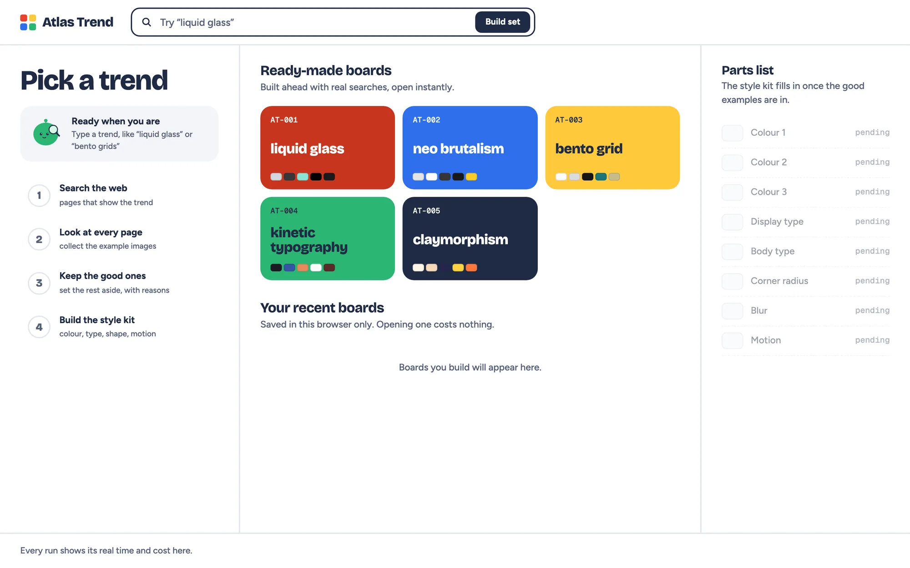

# Atlas Trend

An AI design-research prototype that turns a visual trend into a credited style kit, components, and reusable tokens.

[Portfolio case study](https://vadim-kravets.vercel.app/work/atlas-trend/) · [Vadim Kravets](https://vadim-kravets.vercel.app/)



## My role

Product direction, problem framing, scope, design decisions, and review. AI coding agents wrote implementation code and tests under my direction. This is an independent portfolio project.

## What to explore

- Replayable sample research flow
- Ready-made trend boards and editable design-system components
- Exportable design tokens and project kits

## Try it locally

```sh
npm ci
npm test
npm run dev -- --hostname 127.0.0.1 --port 8102
```

Open http://127.0.0.1:8102/?replay=1 or http://127.0.0.1:8102/?showcase=claymorphism. Samples require no API key. Live research, Ask Scout, and kit regeneration are blocked by default, even if a provider key is present. Sample source links remain credited; third-party thumbnails are omitted from this public copy.

## About this public copy

This is a curated showcase snapshot with fresh Git history. It contains no production credentials, private project-session records, owner databases, or connection to the private working repository. Changes to this copy do not deploy or modify the working app. It has no inherited deployment integration, repository secrets, or paid Actions workflow.

The code can be reviewed and run locally. Forks and proposed changes do not grant write access to the original app. Public source is not a guarantee that software has no bugs.

[Usage and architecture reference](GUIDE.md) · [Publication checks](PUBLICATION.md)

## License and third-party material

Source is shared for portfolio review; no additional open-source license is granted for my original code. Bundled libraries, fonts, and documentation retain their respective licenses and notices.
